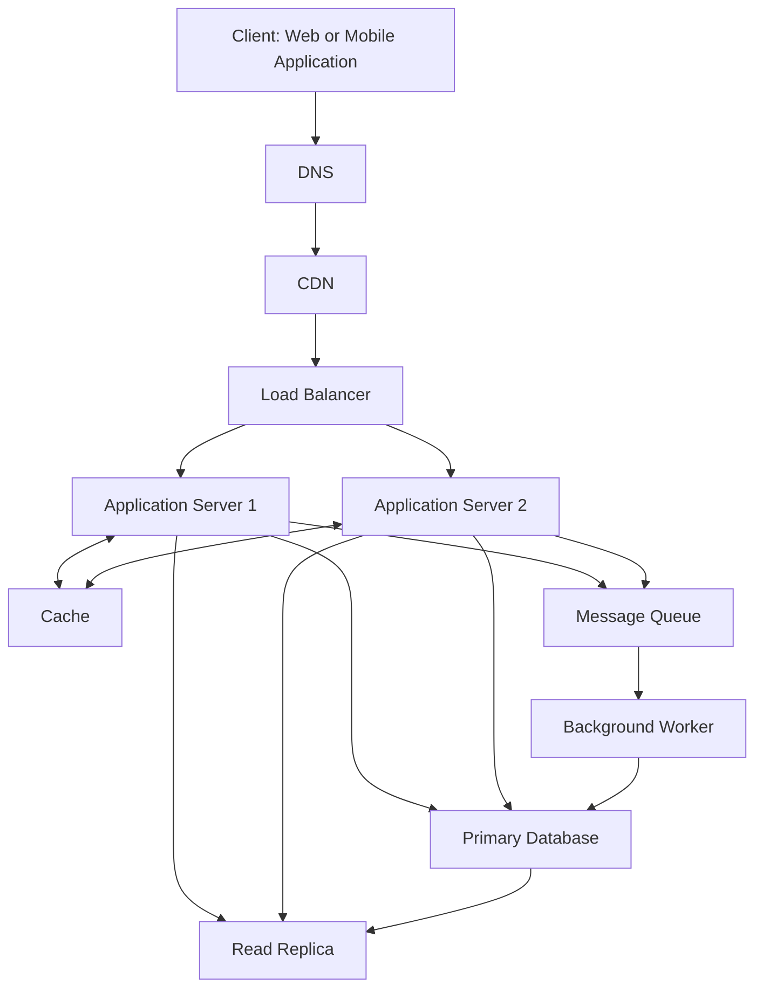

# QuickNotes System Architecture

## 1. Overview

QuickNotes is a note-management application that allows users to create, view, update, delete, and organize their notes.

The system uses a client-server architecture in which the frontend communicates with the backend through a REST API. The backend processes requests, enforces application rules, and communicates with a relational database.

The architecture is designed to support up to 1 million registered users while maintaining performance, availability, security, and scalability.

## 2. System Requirements

### 2.1 Functional Requirements

The system should allow users to:

- Register and authenticate their accounts.
- Create new notes.
- Retrieve and view their existing notes.
- Update notes.
- Delete notes and recover recently deleted notes.
- Organize notes using tags.
- Search and filter their notes.
- Access only their own private information.

### 2.2 Non-Functional Requirements

The system should provide:

- **Scalability:** Support increasing numbers of users and requests by adding application servers and other resources.
- **Availability:** Remain accessible even when an individual application server fails.
- **Performance:** Retrieve frequently requested notes efficiently using caching and database indexing.
- **Security:** Protect user information through authentication, authorization, input validation, and HTTPS.
- **Reliability:** Protect stored information through database replication and regular backups.
- **Maintainability:** Use separate system components that can be updated and maintained independently.

## 3. System Architecture Diagram

The following diagram illustrates the main components and how they communicate.

## 4. System Components

### 4.1 Client

The client is the web or mobile application through which users interact with QuickNotes. It provides the interface for creating, viewing, editing, and deleting notes.

### 4.2 DNS (Domain Name System)

DNS translates the application's domain name into an IP address, allowing users to access the QuickNotes service.

### 4.3 CDN (Content Delivery Network)

The CDN delivers static resources such as images, stylesheets, and JavaScript files from geographically distributed servers. This reduces latency and the workload on the main application infrastructure.

### 4.4 Load Balancer

The load balancer distributes incoming requests across multiple application servers. It prevents one server from handling all requests and helps maintain availability if an application server becomes unavailable.

### 4.5 Application Servers

Application servers process API requests, validate user input, enforce business rules, authenticate users, and communicate with the database.

QuickNotes uses at least two application servers to distribute workloads and reduce dependence on a single server.

### 4.6 Cache

The cache stores frequently requested information, such as recently accessed notes. It reduces repeated database queries and improves response times.

Cached information must be updated or invalidated when the corresponding notes change.

### 4.7 Primary Database

The primary database stores the application's permanent data, including users, notes, tags, and note-tag relationships.

It handles write operations such as creating, updating, and deleting notes.

### 4.8 Read Replica

The read replica maintains a copy of the primary database and handles read requests.

It reduces the workload on the primary database and improves performance when many users retrieve notes simultaneously. Replication may introduce a short delay before new changes appear on the replica.

### 4.9 Message Queue

The message queue stores background tasks that do not need to be completed during the user's immediate request.

For example, note-related notifications or other background processing tasks can be placed in the queue.

### 4.10 Background Worker

The background worker retrieves tasks from the message queue and processes them independently of the main application servers.

This prevents time-consuming background operations from slowing down normal user requests.

## 5. Request and Data Flows

### 5.1 GET /notes — Retrieve Notes

When a user requests their notes:

1. The client sends a `GET /notes` request.
2. DNS resolves the application domain, and the request passes through the CDN and load balancer.
3. The load balancer forwards the request to an available application server.
4. The application server authenticates the user and checks their permissions.
5. The server checks the cache for the requested notes.
6. If the notes are available in the cache, they are returned to the client.
7. If the notes are not cached, the application server retrieves them from the read replica.
8. The retrieved notes can be stored in the cache for subsequent requests.
9. The server returns the notes to the client with a `200 OK` response.

### 5.2 POST /notes — Create a Note

When a user creates a new note:

1. The user enters the note details and clicks Save.
2. The client sends a `POST /notes` request containing the note data.
3. The request passes through DNS, the CDN, and the load balancer.
4. The load balancer forwards it to an available application server.
5. The application server authenticates the user and validates the submitted data.
6. If the request is valid, the application server saves the note in the primary database.
7. The database replicates the new record to the read replica.
8. The application server updates or invalidates any affected cached information.
9. The server returns the newly created note with a `201 Created` response.
10. The client displays the new note to the user.

## 6. Load Estimation

The following estimates demonstrate how QuickNotes could handle 1 million registered users.

### 6.1 Assumptions

- Total registered users: 1,000,000.
- Daily active users (DAU): 10% of registered users.
- Each active user makes 20 read requests per day.
- Each active user makes 2 write requests per day.
- Each new note occupies approximately 2 KB of storage.
- Each active user creates 2 new notes per day.
- One day contains 86,400 seconds.
- One year contains 365 days.

### 6.2 Daily Active Users

\[
1,000,000 \times 0.10 = 100,000
\]

The estimated number of daily active users is 100,000.

### 6.3 Read Requests

Daily read requests:

\[
100,000 \times 20 = 2,000,000
\]

Average reads per second:

\[
\frac{2,000,000}{86,400} = 23.15
\]

**Estimated average read load: 23.15 requests per second.**

### 6.4 Write Requests

Daily write requests:

\[
100,000 \times 2 = 200,000
\]

Average writes per second:

\[
\frac{200,000}{86,400} = 2.31
\]

**Estimated average write load: 2.31 requests per second.**

### 6.5 Storage Estimation

Assuming each active user creates two notes daily, with each note occupying approximately 2 KB:

Daily storage:

\[
200,000 \times 2KB = 400,000KB
\]

Annual storage:

\[
400,000KB \times 365 = 146,000,000KB
\]

**Estimated annual storage: approximately 146 GB.**

This estimate covers note content only. Actual storage requirements would be higher after accounting for indexes, database overhead, backups, and replicated data.

### 6.6 Summary of Load Estimates

| Metric | Estimated Value |
|---|---:|
| Registered users | 1,000,000 |
| Daily active users | 100,000 |
| Daily read requests | 2,000,000 |
| Average reads per second | 23.15 |
| Daily write requests | 200,000 |
| Average writes per second | 2.31 |
| Annual note storage | 146 GB |

These are average estimates. Actual traffic may increase during peak periods, so the infrastructure should be designed with additional capacity.

## 7. Security

QuickNotes must protect users' information and ensure that each user can access only their own notes and tags.

- Users must authenticate before accessing their private notes and tags.
- The backend must verify user permissions before allowing access to data.
- User input must be validated before it is saved to the database.
- Database credentials and other sensitive configuration must not be exposed in the frontend.
- Communication between the frontend and backend should use HTTPS in production.
- Passwords should be stored securely using appropriate password hashing.

## 8. Error Handling

QuickNotes should handle errors and provide meaningful feedback to users.

- If a request contains invalid data, the backend should return a `400 Bad Request` response.
- If a requested note does not exist, the backend should return a `404 Not Found` response.
- If a user is not authenticated, the backend should return a `401 Unauthorized` response.
- If a user lacks permission to access a resource, the backend should return a `403 Forbidden` response.
- If the server encounters an unexpected problem, it should return a `500 Internal Server Error` response.
- The frontend should display a helpful error message when an operation fails.

## 9. Architectural Trade-offs

### 9.1 SQL Database vs NoSQL Database

QuickNotes uses a relational SQL database because its data has structured relationships between users, notes, and tags.

SQL supports foreign keys, constraints, and transactions, which help maintain data consistency. A NoSQL database may provide more flexibility for unstructured data, but the relational structure of QuickNotes makes SQL a suitable choice.

### 9.2 Caching vs Data Consistency

Caching improves performance by reducing repeated database queries. However, cached information may become outdated when notes are created, updated, or deleted.

QuickNotes addresses this by updating or invalidating affected cache entries when data changes. This introduces additional complexity but improves read performance.

### 9.3 Read Replicas vs Immediate Consistency

Read replicas distribute read workloads and reduce pressure on the primary database. However, replication may not happen immediately.

This means a newly created or updated note might take a short time to appear in a read query directed to the replica. The application can retrieve recently changed records from the primary database when immediate consistency is required.

## 10. Availability and Single Points of Failure

A single point of failure is a component whose failure can make the entire system unavailable.

QuickNotes reduces these risks through the following measures:

- **Multiple application servers:** If one application server fails, the load balancer can direct requests to another available server.
- **Database replication:** The read replica provides an additional copy of the data and can support recovery or failover if the primary database becomes unavailable.
- **Regular backups:** Database backups help recover information in case of accidental deletion or database failure.
- **Load balancing:** Requests are distributed across application servers instead of depending on one server.
- **Queue-based background processing:** Background tasks can remain in the queue if a worker temporarily becomes unavailable and can be processed when a worker recovers.

The database primary, DNS, cache, and load balancer can still become points of failure if deployed without redundancy. Production deployment should therefore include appropriate failover, health checks, and recovery mechanisms.

## 11. Conclusion

The proposed QuickNotes architecture separates the client, application logic, and database responsibilities. It uses load balancing, caching, database replication, and background processing to improve performance and availability.

The design provides a foundation for supporting up to 1 million registered users while allowing the system to scale as usage increases.